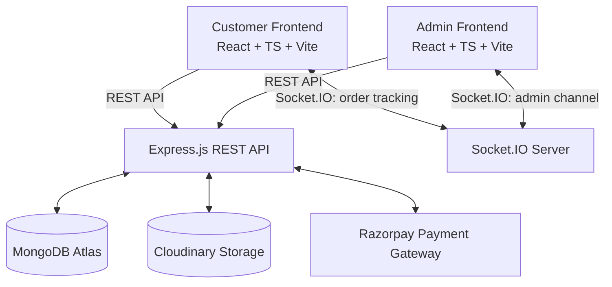
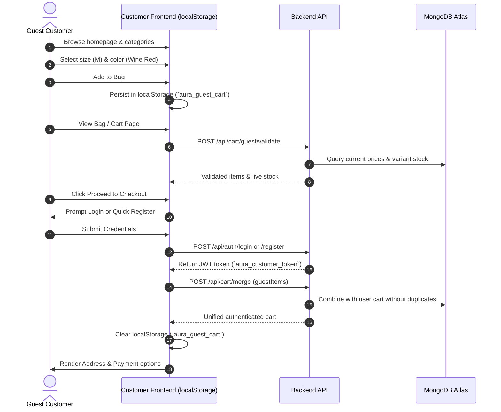

# Aura Fashion - System Architecture

## 1. System Overview

Aura Fashion is an enterprise-grade fashion e-commerce platform designed with three decoupled services:
1. **Customer Frontend**: Luxury shopping portal with guest shopping, dynamic categories, variant selection, and live order tracking.
2. **Admin Frontend**: Standalone executive operations portal with variant-level inventory matrices, dynamic category trees, store settings, and Excel export reports.
3. **Backend API**: Node.js & Express server with Mongoose, Socket.IO, Razorpay, and Cloudinary.

---

## 2. Guest Shopping & Cart Migration Workflow

The system guarantees that customers can browse, filter, inspect fabrics, pick sizes/colors, and build a bag without being prompted to log in. Authentication is requested only at the final checkout step.

---

## 3. Real-Time Socket.IO Channel Architecture

Socket.IO provides real-time bidirectional communication without requiring polling.

### Admin Channel (`admin_room`)
- When an administrator logs into the portal, the frontend sends a `join_admin_channel` event with `token`.
- The server decodes the JWT and validates the `admin` role.
- Upon valid authorization, the socket joins `admin_room`.
- When an order is placed by any customer, the server emits `new_order` to `admin_room`.
- The admin layout displays a live alert toast and increments order counts without needing page reloads.

### Customer Order Tracking Channel (`order_{orderId}`)
- When a customer views their order details page, the client emits `track_order` with `orderId`.
- The socket joins `order_{orderId}`.
- Whenever an admin updates the order status (e.g. `PROCESSING` &rarr; `PACKED` &rarr; `SHIPPED` &rarr; `OUT_FOR_DELIVERY`), the server emits `status_change`.
- The customer's multi-step visual tracker immediately advances with a smooth animation.

---

## 4. Multi-Tenant Session Separation

To prevent cross-portal session contamination, separate storage keys and JWT payloads are enforced:

| Dimension | Customer Application | Admin Application |
|---|---|---|
| Storage Key | `aura_customer_token` | `aura_admin_token` |
| Token Payload `type` | `"customer"` | `"admin"` |
| Port in Dev | `5173` | `5174` |
| Protected Gateways | `/api/orders`, `/api/auth/me` | `/api/variants/*`, `/api/settings`, `/api/reports/*` |

---

## 5. Security & Stock Integrity

1. **bcrypt Hashing**: All passwords hashed with salt work factor 10.
2. **Server-Side Price Validation**: Never trusts prices sent from the client; prices are recalculated on the backend directly from product and variant records.
3. **Atomic Stock Decrement**: Variant stock is validated and decremented on the database during order creation, and an `InventoryTransaction` record is created for full audit traceability.
4. **Signature Verification**: Razorpay HMAC-SHA256 signatures are checked server-side with `crypto.createHmac`.
5. **CORS & Rate Limiting**: Strict headers with Helmet, CORS whitelist for client and admin origins, and express-rate-limit to protect against brute-force attempts.
