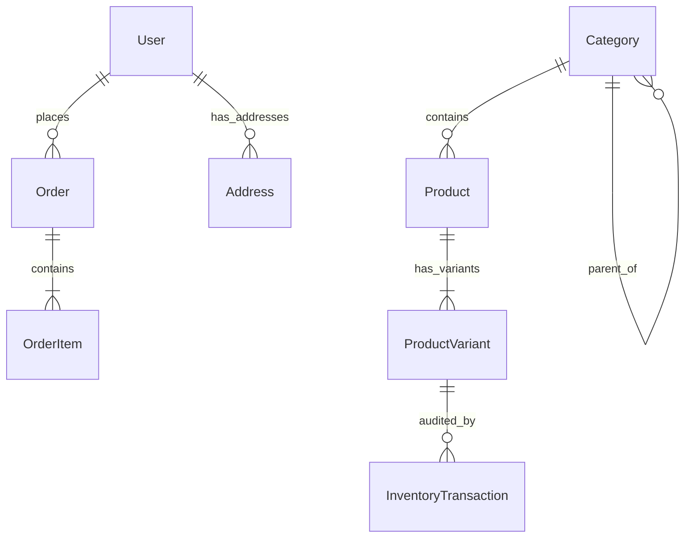

# Aura Fashion - Database Schema Specification

This document details the MongoDB collections and Mongoose schemas used across the platform.

---

## 1. `categories` Collection

| Field | Type | Attributes | Description |
|---|---|---|---|
| `_id` | ObjectId | Primary Key | Category identifier |
| `name` | String | Required, Trim | Name (e.g. "Women's Wear", "Kurtis") |
| `slug` | String | Unique, Indexed | URL slug (e.g. "womens-wear") |
| `description` | String | Optional | Overview of apparel style |
| `image` | Object | `{ url, public_id }` | Cloudinary or fallback image |
| `parentCategory`| ObjectId | Ref `Category`, Default `null` | Main category ID if this is a subcategory |
| `displayOrder` | Number | Default: `0` | Sequence in navigation and homepage |
| `isActive` | Boolean | Default: `true` | Visibility toggle |

---

## 2. `products` Collection

| Field | Type | Attributes | Description |
|---|---|---|---|
| `_id` | ObjectId | Primary Key | Product identifier |
| `name` | String | Required, Trim | Garment title |
| `slug` | String | Unique, Indexed | URL-friendly slug |
| `description` | String | Required | Full description with styling notes |
| `category` | ObjectId | Ref `Category`, Required | Primary category |
| `subcategory` | ObjectId | Ref `Category`, Optional | Child subcategory |
| `brand` | String | Default: `'Aura Fashion'` | Brand label |
| `fabric` | String | Optional | Fabric composition (e.g. Pure Georgette) |
| `specifications`| Array | `[{ key, value }]` | Technical specs (Occasion, Care, Length) |
| `images` | Array | `[{ url, public_id, isPrimary, altText }]` | High-res photography |
| `basePrice` | Number | Required, Min: 0 | MRP / standard price in INR |
| `discountPrice`| Number | Optional, Must be < basePrice | Active promotional sale price |
| `tags` | Array | Strings | Search keywords |
| `isFeatured` | Boolean | Default: `false` | Shown on homepage featured grid |
| `isNewArrival` | Boolean | Default: `false` | Highlighted as new season |
| `isTrending` | Boolean | Default: `false` | Trending badge |
| `isBestSeller` | Boolean | Default: `false` | Best-seller label |
| `isActive` | Boolean | Default: `true` | Storefront visibility |

---

## 3. `productvariants` Collection

This collection implements clothing variant-level inventory.

| Field | Type | Attributes | Description |
|---|---|---|---|
| `_id` | ObjectId | Primary Key | Variant ID |
| `product` | ObjectId | Ref `Product`, Required, Indexed | Parent garment reference |
| `size` | String | Required (e.g. `S`, `M`, `L`, `XL`, `32`) | Size specification |
| `color` | String | Required (e.g. `Wine Red`, `Royal Navy`) | Color name |
| `colorCode` | String | Default: `'#000000'` | Hex color swatch for UI display |
| `sku` | String | Required, Unique, Indexed | Unique Stock Keeping Unit |
| `stockQuantity` | Number | Required, Min: 0 | Available physical pieces |
| `additionalPrice`| Number | Default: 0 | Price delta for plus size / bespoke variant |
| `isActive` | Boolean | Default: `true` | Variant status |

> [!NOTE]
> A unique compound index `{ product: 1, size: 1, color: 1 }` prevents duplicate variant combinations on any product.

---

## 4. `users` Collection

| Field | Type | Attributes | Description |
|---|---|---|---|
| `_id` | ObjectId | Primary Key | User ID |
| `name` | String | Required | Customer full name |
| `email` | String | Required, Unique, Lowercase | Customer email address |
| `password` | String | Required, Min: 6, `select: false` | bcrypt hashed password |
| `phone` | String | Optional | Contact phone number |
| `role` | String | Default: `'customer'` | Authorization role |
| `addresses` | Array | Subdocuments | Saved delivery locations |
| `wishlist` | Array | Ref `Product` | Saved garment IDs |

---

## 5. `admins` Collection

| Field | Type | Attributes | Description |
|---|---|---|---|
| `_id` | ObjectId | Primary Key | Admin ID |
| `name` | String | Required | Administrator name (e.g. Kainath) |
| `email` | String | Required, Unique, Lowercase | Admin login email |
| `password` | String | Required, `select: false` | bcrypt hashed password |
| `role` | String | Enum: `['superadmin', 'manager', 'staff']` | Administrative privileges |
| `isActive` | Boolean | Default: `true` | Account access toggle |
| `lastLogin` | Date | Optional | Timestamp of last session |

---

## 6. `orders` Collection

| Field | Type | Attributes | Description |
|---|---|---|---|
| `_id` | ObjectId | Primary Key | Internal order ID |
| `orderNumber` | String | Required, Unique, Indexed | Human-readable identifier (`AF-YYYYMMDD-XXXX`) |
| `user` | ObjectId | Ref `User`, Required, Indexed | Customer reference |
| `customerInfo` | Object | `{ name, email, phone }` | Customer snapshot at time of purchase |
| `shippingAddress`| Object | Full postal details | Snapshot of delivery location |
| `items` | Array | Order item snapshots | Product, variant, SKU, size, color, verified price |
| `pricing` | Object | `{ itemsTotal, deliveryCharge, couponCode, discountAmount, grandTotal }` | Financial audit ledger |
| `paymentMethod` | String | Enum: `['RAZORPAY', 'COD']` | Payment channel |
| `paymentInfo` | Object | `{ razorpayOrderId, razorpayPaymentId, status, paidAt }` | Payment transaction state |
| `orderStatus` | String | Enum: `['PENDING', 'CONFIRMED', 'PROCESSING', 'PACKED', 'SHIPPED', 'OUT_FOR_DELIVERY', 'DELIVERED', 'CANCELLED', 'RETURNED']` | Active lifecycle stage |
| `statusHistory` | Array | `[{ status, timestamp, comment, updatedBy }]` | Complete chronological audit log |
| `trackingNumber`| String | Optional | Courier AWB tracking code |

---

## 7. `storesettings` Collection

Stores single-document configuration with client data for **Kainath**, Bengaluru:
- `shopName`: `'Aura Fashion'`
- `ownerName`: `'Kainath'`
- `shopAddress`: `'Bengaluru'`
- `shopLocation`: `'Bengaluru, Karnataka, India'`
- `contactNumber`: `'7022018850'`
- `whatsappNumber`: `'7022018850'`
- `email`: `'shoppe.aurafashion@gmail.com'`
- `deliveryCharge`, `freeDeliveryThreshold`, `codAvailable`
- `primaryColor`, `accentColor`, `returnPolicy`, `exchangePolicy`, `refundPolicy`, `businessHours`

---

## 8. `inventorytransactions` Collection

Maintains an immutable historical audit trail of all stock movements:
- `product`: Ref `Product`
- `variant`: Ref `ProductVariant`
- `sku`: Variant SKU
- `type`: `PURCHASE` | `MANUAL_ADJUSTMENT` | `RESTOCK` | `CANCELLED_RETURN` | `INITIAL_STOCK`
- `quantityDelta`: Stock change (e.g. `-2` for purchase, `+2` for cancellation)
- `previousStock`: Stock before action
- `newStock`: Resulting stock
- `reason`: Order number or manual override explanation
- `performedBy`: User or Admin name
